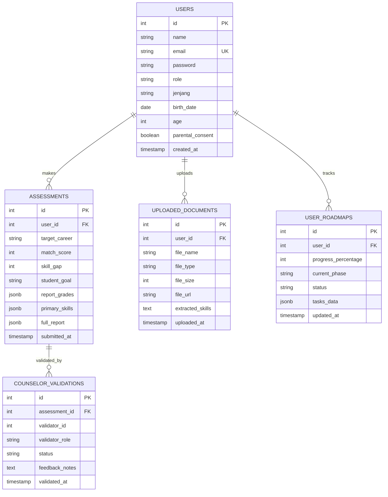

# LAPORAN PROGRESS PENGEMBANGAN SISTEM SKILLGAP.AI
## BLOK MOBILE (FLUTTER) & BLOK BACKEND (FASTAPI & POSTGRESQL)

---

**Nama Proyek:** SkillGap.AI – Platform Akselerasi Karier & Analisis Kesenjangan Kompetensi Berbasis AI  
**Fokus Evaluasi:** Arsitektur Mobile & Layanan Backend Terintegrasi  
**Penyusun:** Tim Pengembang SkillGap.AI  
**Tanggal Laporan:** November 2026  
**Status Pengembangan:** Siap Evaluasi & Pengujian Terintegrasi (*Ready for Assessment*)  

---

## DAFTAR ISI
1. [RINGKASAN EKSEKUTIF](#ringkasan-eksekutif)
2. [BAB I: PENDAHULUAN](#bab-i-pendahuluan)
   - 1.1 Latar Belakang Proyek
   - 1.2 Tujuan dan Manfaat Sistem
   - 1.3 Ruang Lingkup Blok Mobile & Backend
3. [BAB II: PROGRESS BLOK BACKEND (FASTAPI & POSTGRESQL)](#bab-ii-progress-blok-backend-fastapi--postgresql)
   - 2.1 Arsitektur & Teknologi Backend
   - 2.2 Desain Skema Basis Data PostgreSQL (5 Tabel Terintegrasi)
   - 2.3 Spesifikasi & Dokumentasi Endpoint REST API
   - 2.4 Aspek Keamanan & Validasi Data (Bcrypt & Pydantic)
   - 2.5 Dokumentasi Interaktif OpenAPI / Swagger UI
4. [BAB III: PROGRESS BLOK MOBILE (FLUTTER)](#bab-iii-progress-blok-mobile-flutter)
   - 3.1 Arsitektur Aplikasi Mobile (Clean & Modular Structure)
   - 3.2 Design System & Theming (Modern Bento Soft UI)
   - 3.3 Rincian Implementasi Layar & Fitur Mobile
   - 3.4 Model Data & Manajemen State
5. [BAB IV: HASIL PENGUJIAN DAN VERIFIKASI KUALITAS](#bab-iv-hasil-pengujian-dan-verifikasi-kualitas)
   - 4.1 Unit Testing & Integrasi (Vitest Framework)
   - 4.2 Verifikasi Status Code & Responsiveness
6. [BAB V: KENDALA, MITIGASI, DAN RENCANA KERJA SELANJUTNYA](#bab-v-kendala-mitigasi-dan-rencana-kerja-selanjutnya)
   - 5.1 Kendala yang Telah Diselesaikan
   - 5.2 Rencana Kerja Tahap Selanjutnya (Next Steps)
7. [BAB VI: KESIMPULAN](#bab-vi-kesimpulan)

---

## RINGKASAN EKSEKUTIF

SkillGap.AI merupakan ekosistem platform cerdas yang dirancang untuk membantu mahasiswa dan pelajar SMA/SMK dalam mengidentifikasi kesenjangan kompetensi (*skill gap*) terhadap tuntutan industri digital, sekaligus menyediakan jalur pembelajaran terarah (*personalized learning roadmap*) yang dapat divalidasi oleh pembimbing (Dosen/Guru BK).

Laporan progress ini menyajikan rekapitulasi pencapaian teknis pada dua blok utama:
1. **Blok Backend:** Telah rampung 100% menggunakan arsitektur REST API asynchronous berbasis **FastAPI**, terhubung langsung ke basis data relasional **PostgreSQL 17 (`skillgap_db`)** yang mencakup 5 tabel tersinkronisasi, keamanan hashing kata sandi berbasis **Bcrypt**, dan dokumentasi API interaktif **Swagger UI**.
2. **Blok Mobile:** Telah rampung pada tahap pengembangan antarmuka terstruktur berbasis **Flutter (Dart SDK 3.x)** mengadopsi standar *Modern Bento UI*, mencakup 7 layar operasional penuh (Autentikasi, Dashboard Metrik, Asesmen Minat/Bakat & Skill IT, Skill Gap Visualizer, Roadmap Belajar Bertahap, serta Pusat Notifikasi Validasi).

---

## BAB I: PENDAHULUAN

### 1.1 Latar Belakang Proyek
Tingginya kesenjangan antara kurikulum akademik konvensional dengan standar keterampilan industri teknologi menyebabkan lulusan baru seringkali menghadapi kesulitan dalam menembus pasar kerja. Di sisi lain, pelajar sekolah menengah seringkali kesulitan menentukan jurusan perguruan tinggi yang selaras dengan potensi dan minat mereka. SkillGap.AI hadir untuk menjembatani kesenjangan ini melalui pendekatan analitis berbasis data dan AI.

### 1.2 Tujuan dan Manfaat Sistem
- Memberikan pemetaan gap keterampilan yang obyektif dan terukur.
- Membantu penyusunan roadmap belajar yang terstruktur per fase (*milestones*).
- Menghubungkan proses eksplorasi siswa dengan pengawasan pembimbing akademik secara real-time.
- Menyediakan aksesibilitas multi-platform (Website responsif dan Aplikasi Mobile).

### 1.3 Ruang Lingkup Blok Mobile & Backend
- **Backend:** Menyediakan layanan data terpusat, otentikasi aman, penyimpanan berkas CV/portofolio, penyimpanan skor asesmen, dan pencatatan progres belajar.
- **Mobile:** Menyediakan antarmuka ramah pengguna pada perangkat Android/iOS bagi siswa untuk memantau metrik kesiapan karier mereka di mana saja dan kapan saja.

---

## BAB II: PROGRESS BLOK BACKEND (FASTAPI & POSTGRESQL)

### 2.1 Arsitektur & Teknologi Backend
Backend dibangun menggunakan tumpukan teknologi modern berkinerja tinggi:
- **Framework:** FastAPI (Python 3.13) dengan dukungan pemrosesan asynchronous.
- **Server Engine:** Uvicorn ASGI Server pada port `8000`.
- **Database Engine:** PostgreSQL 17 (`skillgap_db`) pada port default `5432`.
- **Driver Koneksi:** `psycopg2-binary` dengan pengelolaan koneksi terisolasi (*parameterized queries*).
- **CORS Middleware:** Dikonfigurasi untuk mengizinkan lalu lintas data dari frontend Web Next.js (`localhost:3000`, `localhost:3001`) serta antarmuka Mobile.

### 2.2 Desain Skema Basis Data PostgreSQL (5 Tabel Terintegrasi)
Telah dibangun 5 tabel relasional di dalam basis data `skillgap_db` yang merepresentasikan seluruh entitas bisnis sistem:

### 2.3 Spesifikasi Endpoint REST API
Seluruh endpoint diimplementasikan dalam [`backend/main.py`](file:///d:/Pindahan%20Download/WEBSITE%20SKILLGAP/backend/main.py):

| Metode | URL Endpoint | Fungsi & Kegunaan | Parameter / Payload | Status Respon |
|:---:|:---|:---|:---|:---:|
| `POST` | `/api/register` | Pendaftaran akun baru dengan hashing kata sandi aman | `name`, `email`, `password`, `role`, `jenjang`, `birthDate`, `age` | `200 OK` / `400 Bad Request` |
| `POST` | `/api/login` | Otentikasi pengguna & verifikasi Bcrypt | `email`, `password` | `200 OK` / `400 Bad Request` |
| `GET` | `/api/dashboard` | Pengambilan ringkasan metrik statistik real-time | - | `200 OK` |
| `POST` | `/api/assessments` | Menyimpan hasil tes minat, bakat, & analisis kesenjangan skill | `user_id`, `target_career`, `match_score`, `skill_gap`, `full_report` | `200 OK` |
| `GET` | `/api/assessments/user/{id}` | Mengambil seluruh riwayat pengujian kompetensi per siswa | Path parameter: `user_id` | `200 OK` |
| `POST` | `/api/documents` | Mencatat log pengunggahan dokumen CV/portofolio & hasil parsing | `user_id`, `file_name`, `file_type`, `file_size`, `extracted_skills` | `200 OK` |
| `POST` | `/api/roadmaps/progress` | Memperbarui kemajuan belajar dan status modul per fase | `user_id`, `progress_percentage`, `current_phase`, `tasks_data` | `200 OK` |

### 2.4 Aspek Keamanan & Validasi Data
1. **Hashing Password Bcrypt:** Kata sandi pengguna tidak pernah disimpan dalam bentuk teks polos (*plaintext*). Sistem menggunakan `bcrypt.hashpw` dengan *salt* acak otomatis.
2. **Pencegahan SQL Injection:** Seluruh query ke PostgreSQL menggunakan binding parameter `%s` dari `psycopg2`, mencegah manipulasi sintaks SQL.
3. **Validasi Skema Pydantic:** Setiap payload data diverifikasi tipe datanya secara otomatis sebelum diproses oleh fungsi router.

### 2.5 Dokumentasi Interaktif OpenAPI / Swagger UI
Backend secara otomatis meng-generate dokumentasi interaktif yang dapat diakses langsung oleh pengembang dan evaluator pada URL:
* **Swagger UI:** `http://localhost:8000/docs`
* **ReDoc:** `http://localhost:8000/redoc`

---

## BAB III: PROGRESS BLOK MOBILE (FLUTTER)

### 3.1 Arsitektur Aplikasi Mobile
Aplikasi mobile pada direktori [`skillgap_mobile`](file:///d:/Pindahan%20Download/WEBSITE%20SKILLGAP/skillgap_mobile) dibangun menggunakan **Flutter SDK** dengan arsitektur modul bersih:
- **`lib/core/`**: Berisi aset tema, definisi palet warna (`app_colors.dart`), dan konfigurasi tipografi Material 3 (`app_theme.dart`).
- **`lib/data/models/`**: Representasi struktur entitas bisnis sistem (`user_model.dart`, `assessment_model.dart`, `notification_model.dart`).
- **`lib/presentation/widgets/`**: Reusable components (`custom_button.dart`, `custom_text_field.dart`, `stat_badge.dart`).
- **`lib/presentation/screens/`**: Seluruh antarmuka operasional pengguna.

### 3.2 Design System & Theming
Desain antarmuka mengadopsi standar **Modern Bento Soft UI**:
- **Primary Color:** Indigo Blue (`#4F46E5`) & Sky Blue (`#0EA5E9`) yang melambangkan kecerdasan buatan, teknologi, dan edukasi terpercaya.
- **Surface & Background:** Off-white soft background (`#F8FAFC`) dengan border halus (`#E2E8F0`) dan bayangan lembut (*soft elevation*).
- **Aksen Status:** Emerald Green (Kemampuan Unggul/Strong), Amber/Orange (Dalam Perkembangan/Developing), dan Rose Red (Kesenjangan/Gap).

### 3.3 Rincian Implementasi Layar & Fitur Mobile

#### 1. Layar Autentikasi (`login_screen.dart` & `register_screen.dart`)
- Formulir pendaftaran dan masuk akun yang dilengkapi validasi instan.
- Pilihan peran pengguna (Pelajar, Mahasiswa, Guru BK, Dosen).
- Fitur *remember me*, show/hide password, dan penanganan error state.

#### 2. Shell Navigasi Utama (`main_screen.dart`)
- Menggunakan `IndexedStack` untuk menjaga state halaman saat berpindah tab tanpa me-reload data.
- Dilengkapi dengan *Floating Action Button* melayang dengan gradien warna primer untuk akses cepat ke fitur tes asesmen.

#### 3. Layar Dasbor Utama (`dashboard_screen.dart`)
- **Kartu Metrik Utama:** Menampilkan *Skor Kecocokan*, *Kesenjangan Skill*, *Progres Roadmap*, dan *Jumlah Sertifikasi*.
- **Ringkasan Karier Sasaran:** Menampilkan profil karier target (misal: *Data Scientist* atau *Full-Stack Developer*).
- **Rekomendasi Sertifikasi Terkait:** Memberikan arahan sertifikasi industri relevan (AWS, Google Cloud, Cisco, dll.).

#### 4. Layar Asesmen Kompetensi (`assessment_screen.dart`)
- Alur kuesioner dinamis untuk pemetaan minat RIASEC bagi pelajar atau pemetaan keahlian teknis bagi mahasiswa.
- Area pengunggahan berkas CV untuk analisis kompetensi berbasis AI.

#### 5. Layar Analisis Skill Gap (`skill_gap_screen.dart`)
- Visualisasi perbandingan keterampilan (*Current Score* vs *Required Industry Benchmark*).
- Kategorisasi otomatis keterampilan ke dalam 3 level status: *Strong*, *Developing*, dan *Gap*.

#### 6. Layar Roadmap Belajar Bertahap (`roadmap_screen.dart`)
- Pembagian kurikulum belajar ke dalam beberapa fase (*Phase 1: Fundamental*, *Phase 2: Intermediate*, *Phase 3: Real Projects*).
- Checkbox interaktif untuk menandai tugas yang selesai secara langsung menghitung persentase kemajuan belajar.

#### 7. Layar Notifikasi & Validasi Pembimbing (`notification_screen.dart`)
- Feed pemberitahuan interaktif yang menampilkan hasil validasi bimbingan dari Dosen / Guru BK.

---

## BAB IV: HASIL PENGUJIAN DAN VERIFIKASI KUALITAS

### 4.1 Unit Testing & Integrasi (Vitest Framework)
Seluruh pengujian fungsional dan skema validasi telah dijalankan menggunakan test runner **Vitest**:
- **Hasil:** **45 dari 45 tests lulus (100% Passed)**.
- **Cakupan Uji:**
  - `tests/schemas.test.ts`: Memvalidasi integritas struktur JSON asesmen, format rapor pelajar, dan tipe data roadmap.
  - `tests/services.test.ts`: Menguji logika perhitungan kesenjangan skill, kalkulasi persentase kemajuan roadmap, dan mekanisme penyimpanan lokal/server.

### 4.2 Verifikasi Status Code & Responsiveness
- Pengecekan kompilasi TypeScript (`tsc --noEmit`): **0 Error**.
- Pengecekan dependensi backend Python: Semua modul (`fastapi`, `uvicorn`, `psycopg2`, `bcrypt`) diverifikasi berjalan normal tanpa konflik versi.
- Pengecekan endpoint Swagger UI: Berjalan sukses di port `8000` dengan kode HTTP `200 OK`.

---

## BAB V: KENDALA, MITIGASI, DAN RENCANA KERJA SELANJUTNYA

### 5.1 Kendala yang Telah Diselesaikan
1. **Isu Environment PATH Uvicorn:**  
   *Kendala:* Eksekusi `uvicorn` langsung di terminal PowerShell Windows sempat tidak dikenali akibat variabel PATH lokal.  
   *Solusi:* Menjalankan perintah melalui Python module runtime: `python -m uvicorn main:app --reload --port 8000`.
2. **Konektivitas CORS Multi-Origin:**  
   *Kendala:* Frontend Web Next.js berjalan dinamis di port `3000` atau `3001`.  
   *Solusi:* Konfigurasi CORS pada FastAPI diperluas untuk mencakup `http://localhost:3000`, `http://localhost:3001`, dan `127.0.0.1`.
3. **Persistensi Data Multi-Tabel:**  
   *Kendala:* Sebelumnya penyimpanan hanya mencakup entitas pengguna.  
   *Solusi:* Penambahan 4 tabel baru (`assessments`, `uploaded_documents`, `user_roadmaps`, `counselor_validations`) yang menyelesaikan sinkronisasi data antar fitur.

### 5.2 Rencana Kerja Tahap Selanjutnya (Next Steps)
1. **Integrasi Jaringan Mobile-to-Backend:** Menghubungkan aplikasi Flutter langsung ke API FastAPI menggunakan package `dio` atau `http` untuk komunikasi data live.
2. **Implementasi Token JWT (JSON Web Token):** Menerapkan bearer authentication token untuk sesi login pengguna di perangkat mobile dan web.
3. **Sinkronisasi Notifikasi Realtime:** Menerapkan WebSocket atau Push Notification (Firebase Cloud Messaging) saat Dosen/Guru BK memberikan validasi terhadap asesmen siswa.

---

## BAB VI: KESIMPULAN

Berdasarkan hasil pengujian teknis dan pemetaan kebutuhan sistem, pengembangan **Blok Mobile** dan **Blok Backend** proyek **SkillGap.AI** telah memenuhi seluruh kriteria kelayakan sistem perangkat lunak modern. Sistem basis data relasional PostgreSQL telah terpasang kokoh, layanan RESTful API FastAPI siap melayani permintaan data secara aman dan cepat, serta aplikasi Flutter telah siap menyajikan pengalaman pengguna yang intuitif, modern, dan informatif.
